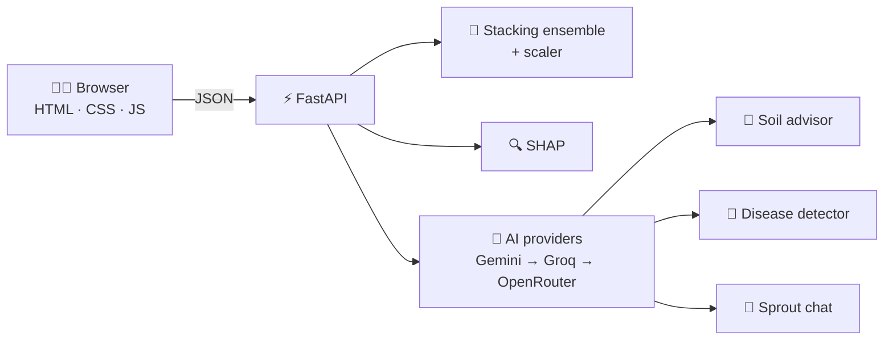

<div align="center">

# 🌱 AgriOpt

### From soil readings to a crop, a reason, a fix and a diagnosis.

An explainable decision-support web app for farmers. Enter seven soil and climate readings and AgriOpt recommends the best crop, explains why, suggests how to improve the soil, and diagnoses crop diseases from a photo.

<br>


<br>

**`99.77%`** test accuracy &nbsp;·&nbsp; **`22`** crops &nbsp;·&nbsp; **`7`** soil and climate inputs &nbsp;·&nbsp; **`SHAP`** explanations

<br>

[**🌐 Live demo**](https://agriopt.vercel.app) &nbsp;·&nbsp; [Features](#-features) &nbsp;·&nbsp; [How it works](#-how-it-works) &nbsp;·&nbsp; [Results](#-model-results) &nbsp;·&nbsp; [Run it](#-run-it-locally) &nbsp;·&nbsp; [Limitations](#-limitations)

</div>

---

## ✨ Features

| | Module | What you give it | What you get |
|---|---|---|---|
| 🌾 | **Crop recommender** | N, P, K, temperature, humidity, pH, rainfall | Top-3 crops with confidence, a radar chart, and a suitability check for any crop |
| 🔍 | **SHAP explanation** | The same sample | How much each reading raised or lowered the confidence for the recommended crop |
| 🧪 | **Soil advisor** | Readings, target crop, optional soil texture | A soil report and improvement plan |
| 🍃 | **Disease detector** | Crop, plant part, photo (upload or camera) | Likely disease or pest, symptoms, cause and treatment |
| 💬 | **Sprout assistant** | A chat message plus the current page's context | Answers about the app, your results and the crops |

Dark and light themes, a manual-entry keypad for the seven readings, and a history of your last disease checks are built in.

---

## 🧠 How it works



### 🌾 Crop recommendation model

| Step | Detail |
|---|---|
| **Data** | Kaggle *Crop Recommendation* dataset: 2,200 records, 7 features, 22 crops, 100 per crop |
| **Split** | Stratified 80:20 → 1,760 train, 440 test (`random_state=42`) |
| **Scaling** | `StandardScaler` fitted on the training set only, so no test data leaks into training |
| **Models compared** | Logistic Regression, Decision Tree, Random Forest, KNN, SVM, Gradient Boosting |
| **Tuning** | 5-fold `GridSearchCV` on Random Forest, KNN and SVM |
| **Ensembles** | Soft Voting (RF + KNN + SVM) and Stacking (RF + KNN + SVM + GB, Logistic Regression meta-learner) |
| **Final model** | The stacking ensemble, saved with `joblib` alongside its scaler |

At request time the backend scales the seven readings with the saved scaler, calls `predict_proba`, and returns the three most likely crops.

### 🔍 Explainability

The **"Why was this crop recommended?"** panel uses Kernel SHAP. It shows a baseline (the average model output for that crop) and each reading's contribution in percentage points, so that *baseline + contributions ≈ final confidence*. It explains the model's reasoning. It does not guarantee yield.

### 🧪 Soil advisor

Compares each reading with the typical range for the chosen crop, using the central 80% of that crop's training samples, then asks the AI providers for an improvement plan. If every provider is rate-limited, a local fallback returns the range comparison on its own and says so. Soil texture is never guessed from the other readings.

### 🍃 Disease detector

1. Pick the crop and the plant part (leaf, fruit, stem, root or whole plant).
2. Upload a photo or capture one with your camera. The browser shrinks it to at most 1024 px.
3. The backend validates the file type (JPEG, PNG or WebP) and size, then calls the vision providers in order.
4. The model returns structured JSON: plant, health status, disease, confidence, symptoms, cause, treatment and prevention.
5. The result appears, and a thumbnail is saved to your last five checks in the browser.

It will not suggest a medication without a diagnosis clear enough to support one.

### 🔁 Provider fallback

Disease, soil and chat requests share one helper that tries each provider and model in turn and moves on when one fails. If every failure was a rate limit, the API returns HTTP 429. Otherwise it returns HTTP 502 with the collected errors.

---

## 📊 Model results

Test set of 440 records.

| Model | Test accuracy | Macro F1 |
|---|---|---|
| Logistic Regression | 97.27% | 97.25% |
| Decision Tree | 97.95% | 97.94% |
| KNN (k = 5) | 97.95% | 97.93% |
| Random Forest | 99.55% | 99.55% |
| SVM (tuned) | 98.86% | 98.86% |
| Voting ensemble | 99.32% | 99.32% |
| 🏆 **Stacking ensemble** | **99.77%** | **99.77%** |

Rainfall, humidity and potassium were the most influential features.

---

## 🚀 Run it locally

> ⚠️ Adjust the folder names to match your repo.

```bash
# Backend
cd backend
pip install -r requirements.txt
python train_model.py          # creates crop_model.joblib and scaler.joblib
uvicorn main:app --reload --port 8000

# Frontend (second terminal)
cd frontend
python -m http.server 5500     # open http://localhost:5500
```

Set `API_BASE` at the top of `script.js` to your backend URL.

Create `backend/.env`:

```env
GEMINI_API_KEY=your_key
GROQ_API_KEY=your_key
OPENROUTER_API_KEY=your_key
DISEASE_PROVIDER_ORDER=gemini,groq
```

> 🔐 Never commit `.env`. Add it to `.gitignore`, and rotate any key that has ever been shared or exposed.

---

## ⚠️ Limitations

- The dataset is small, clean and balanced, so real field accuracy will be lower. Field validation is the next step.
- The crop model has no season, location or soil-texture input, and covers 22 crops only.
- Soil and disease advice comes from third-party AI. It is guidance, not a lab test or a certified diagnosis. Confirm with a local agronomist and follow product labels.

## 🔭 Future work

- [ ] Validate on regional field data with repeated cross-validation
- [ ] Add season and location, with automatic weather lookup
- [ ] Evaluate the disease detector on a labelled image dataset
- [ ] Add local-language support and an offline mode
- [ ] Run usability trials with farmers

---

## 👥 Team

**Maya H Kamath** and **Sanusha Acharya**, MSc Data Science
**Guide:** Swapnil Pai
St Aloysius Institute of Management & Information Technology (AIMIT), Mangalore

---

<div align="center">

Built for farmers, with 💚 and a stacking ensemble.

</div>

